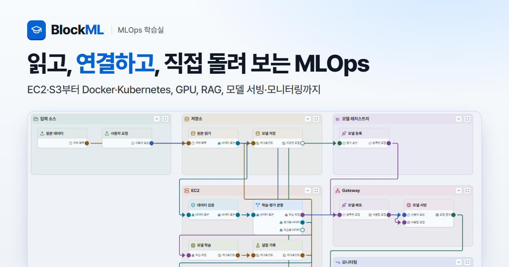
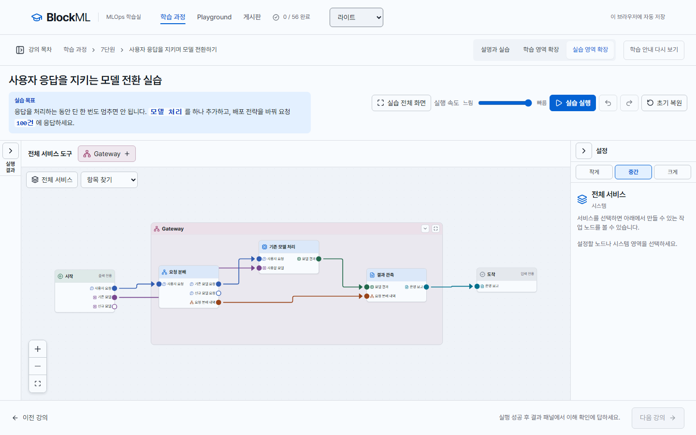

# BlockML



**MLOps를 읽고, 직접 연결하고, 실행해 보며 배우는 학습 사이트입니다.**

모델은 학습해 봤지만, 인프라와 연계해서 서비스로 내보내는 과정(서버, 컨테이너, 데이터, 배포, 모니터링)은 어렵다고 생각하는 사람이 많습니다. 노드 기반의 학습으로 MLops 과정을 쉽게 이해할 수 있도록 만든 학습 플랫폼입니다.

## 주요 기능

### 강의와 노드 실습

단순히 글을 읽고 학습하는 것에서 끝나지 않습니다. 노드를 만들어보고, 연결해보며, 설정을 바꾸면서 최종 목표를 달성하기 위해 여러 실습을 수행합니다.



### Playground

단원 실습에서 쓴 서비스와 노드를 자유롭게 연결해 나만의 MLOps 파이프라인을 만듭니다.


### 워크플로우 게시판

Playground에서 만든 구성을 글과 함께 올려 공유하고, 다른 사람의 구성을 불러와 Playground에서 이어서 실행합니다.

### AI 조언

실습이 실패하면 "AI 조언 받기"로 정답을 알려 주지 않는 질문형 힌트를 받습니다. 이해 확인의 답안 평가와 강의 질문 답변에도 AI를 사용합니다.

## 기술 스택

**프론트엔드**

        

**백엔드**

    

**AI**


**테스트**

  

**배포·인프라**

    

AI는 Chat Completions 호환 vLLM 서버를 쓰고, 응답 형식 테스트셋은 `llm/`에 있습니다.

## 빠른 실행

필요한 것: Node.js 24, JDK 25(백엔드), Docker·minikube·kubectl·Helm(쿠버네티스 배포).

### 프론트엔드만 실행

강의, 노드 실습, Playground는 백엔드 없이 동작합니다. 게시판과 AI 조언은 백엔드가 필요합니다.

```sh
cd Frontend
npm ci
npm run dev
```

터미널에 표시된 주소(`http://127.0.0.1:5173` 등)를 브라우저로 엽니다. 백엔드 주소는 `BACKEND_URL` 환경 변수로 바꿀 수 있고 기본값은 `http://localhost:8080`입니다.

```sh
npm run typecheck   # 타입 검사
npm run lint        # 린트
npm test            # 단위 테스트
npm run test:e2e    # 브라우저 테스트 (Playwright)
npm run build       # 빌드
```

### 백엔드 실행

`.env.example`을 `.env`로 복사해 값을 채웁니다. 백엔드는 실행한 위치의 `.env`를 읽습니다.

| 변수              | 설명                           |
| ----------------- | ------------------------------ |
| `SUPABASE_DB_URL` | PostgreSQL(Supabase) 접속 주소 |
| `VLLM_BASE_URL`   | vLLM 서버 주소                 |
| `VLLM_API_KEY`    | vLLM API 키                    |

```sh
cd backend
./gradlew bootRun    # Windows PowerShell: .\gradlew.bat bootRun
```

### 쿠버네티스(minikube)로 전체 실행

프로젝트 루트에 `.env`를 만든 뒤 `make up`으로 빌드, 이미지 로드, 배포, 점검을 한 번에 합니다.
Makefile은 sh 문법이라 Windows에서는 PowerShell이 아니라 **Git Bash**에서 실행해야 합니다.

```sh
minikube start
make up
kubectl --context minikube port-forward -n container-3 svc/blockml-frontend 8081:80
```

이제 `http://localhost:8081`로 접속합니다.

## 팀원

[](https://github.com/AWS-project-konkuk/AWS_project/graphs/contributors)

사진을 누르면 이름이 있는 전체 기여자 목록으로 이동합니다. `main`에 커밋한 사람이 늘면 자동으로 추가됩니다.

## 기여 방법

1. **이슈 확인:** 작업할 내용이 이슈에 있는지 확인하고, 없으면 먼저 이슈를 만듭니다.
2. **브랜치:** `main`에서 `종류/작업-이름` 형식으로 만듭니다. 예) `feat/playground-library`, `fix/post-json-valid`
3. **작업과 확인:** 프론트엔드는 `npm run typecheck`, `npm run lint`, `npm test`가 통과해야 합니다. 화면을 바꿨다면 `npm run test:e2e`도 돌립니다.
4. **커밋:** `종류: 제목` 한 줄로 씁니다. 종류는 `feat`, `fix`, `refactor`, `test`, `docs`, `build`, `chore`를 씁니다.
5. **PR:** `main`으로 올리고 [PR 템플릿](.github/PULL_REQUEST_TEMPLATE.md)(작업 요약, 변경 사항, 확인 방법)을 채웁니다. 제목의 접두사(`feat:` 등)로 라벨이 자동으로 붙고, 작성자가 자동으로 지정됩니다.
6. **CI와 리뷰:** `Frontend verify`와 `Backend verify`가 통과하고 리뷰를 받으면 머지합니다. 백엔드 테스트는 DB 연결 때문에 가끔 실패할 수 있으니, 코드와 무관해 보이면 실패한 작업만 다시 실행해 보세요.

## 문의와 이슈 제보

버그, 개선 제안, 질문은 [GitHub Issues](https://github.com/AWS-project-konkuk/AWS_project/issues)에 남겨 주세요. 버그는 아래를 적으면 빨리 고칠 수 있습니다.

- 어떤 화면에서 무엇을 했는지(재현 순서)와 기대한 결과, 실제 결과
- 화면 주소(예: `/#/learn/week2-workflow`)와 브라우저, 화면 크기
- 스크린샷이나 오류 메시지
