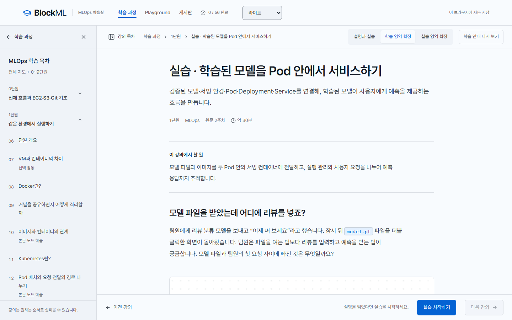
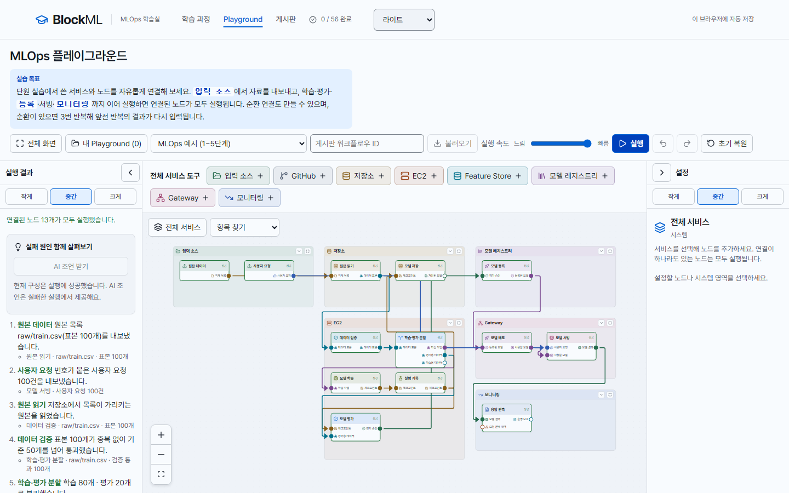

# BlockML

**MLOps를 읽고, 직접 연결하고, 실행해 보며 배우는 학습 사이트입니다.**

모델은 학습해 봤지만 서비스로 내보내는 과정(서버, 컨테이너, 데이터, 배포, 모니터링)은 처음인 사람을 위해 만들었습니다.
EC2·S3·Git 기초부터 Docker·Kubernetes, GPU 학습, 피처, RAG, 모델 서빙·배포 전략, 모니터링까지 0~9단원, 56개 강의를 제공합니다.



> 브라우저 실습은 개념을 이해하기 위한 학습용 모형입니다. 실제 AWS, Docker, 모델 학습, LLM을 실행하지 않으며 화면의 수치는 실제 성능이나 비용을 예측하지 않습니다.

## 주요 기능

### 강의와 노드 실습

글을 읽은 뒤 같은 화면에서 바로 실습합니다. 각 단원의 마지막 강의에는 서비스를 고르고 노드를 만들어 연결하는 종합 실습이 있고, 본문 중간에는 개념을 확인하는 짧은 활동이 있습니다.


- 서비스(EC2, 저장소, Gateway 등)에서 노드를 만들고, 같은 자료 타입의 포트끼리 연결해 실행합니다.
- 일부러 틀린 구성의 실패와 고친 구성의 성공을 비교합니다. 실패하면 처음 실패한 노드의 이유를 보여 줍니다.
- 이해 확인 문제에 답하면 강의 완료가 기록됩니다. 진도는 브라우저에 저장됩니다.
- 실행 중에는 자료가 선을 따라 움직이고, 실행 속도는 슬라이더로 조절합니다.

### Playground

단원 실습에서 쓴 서비스와 노드를 자유롭게 연결해 나만의 MLOps 파이프라인을 만듭니다.



- 1단계(데이터 검증)부터 5단계(순환하는 개선 루프까지 전체 MLOps)까지 예시를 불러올 수 있습니다.
- 순환 연결을 만들 수 있고, 순환이 있으면 3번 반복해 실행합니다. 반복 학습이 MLOps의 핵심이기 때문입니다.
- 만든 구성은 "내 Playground"에 이름을 붙여 저장·복제·삭제하고 게시판에 올립니다.

### 워크플로우 게시판

Playground에서 만든 구성을 글과 함께 올려 공유하고, 다른 사람의 구성을 불러와 Playground에서 이어서 실행합니다.

### AI 조언

실습이 실패하면 "AI 조언 받기"로 정답을 알려 주지 않는 질문형 힌트를 받습니다. 이해 확인의 답안 평가와 강의 질문 답변에도 AI를 사용합니다.

## 기술 스택

| 구분        | 사용 기술                                                                                          |
| ----------- | -------------------------------------------------------------------------------------------------- |
| 프론트엔드  | React 19, TypeScript, Vite, Tailwind CSS 4, React Router, TanStack Query, Zustand, React Flow, MDX |
| 백엔드      | Java 25, Spring Boot 4 (Web MVC, Validation, Data JPA), PostgreSQL(Supabase)                       |
| AI          | vLLM(Chat Completions 호환 서버), 응답 형식 테스트셋(`llm/`)                                       |
| 테스트      | Vitest, Playwright, JUnit                                                                          |
| 배포·인프라 | Docker, nginx, Kubernetes(minikube), Helm, GitHub Actions                                          |

## 빠른 실행

필요한 것: Node.js 24, JDK 25(백엔드), Docker·minikube·kubectl·Helm(쿠버네티스 배포).

### 프론트엔드만 실행

강의, 노드 실습, Playground는 백엔드 없이 동작합니다. 게시판과 AI 조언은 백엔드가 필요합니다.

```sh
cd Frontend
npm ci
npm run dev
```

터미널에 표시된 주소(`http://127.0.0.1:5173` 등)를 브라우저로 엽니다. 백엔드 주소는 `BACKEND_URL` 환경 변수로 바꿀 수 있고 기본값은 `http://localhost:8080`입니다.

```sh
npm run typecheck   # 타입 검사
npm run lint        # 린트
npm test            # 단위 테스트
npm run test:e2e    # 브라우저 테스트 (Playwright)
npm run build       # 빌드
```

### 백엔드 실행

`.env.example`을 `.env`로 복사해 값을 채웁니다. 백엔드는 실행한 위치의 `.env`를 읽습니다.

| 변수              | 설명                           |
| ----------------- | ------------------------------ |
| `SUPABASE_DB_URL` | PostgreSQL(Supabase) 접속 주소 |
| `VLLM_BASE_URL`   | vLLM 서버 주소                 |
| `VLLM_API_KEY`    | vLLM API 키                    |

```sh
cd backend
./gradlew bootRun    # Windows PowerShell: .\gradlew.bat bootRun
```

### 쿠버네티스(minikube)로 전체 실행

프로젝트 루트에 `.env`를 만든 뒤 `make up`으로 빌드, 이미지 로드, 배포, 점검을 한 번에 합니다.
Makefile은 sh 문법이라 Windows에서는 PowerShell이 아니라 **Git Bash**에서 실행해야 합니다.

```sh
minikube start
make up
kubectl --context minikube port-forward -n container-3 svc/blockml-frontend 8081:80
```

이제 `http://localhost:8081`로 접속합니다.

## 팀원과 역할

| 팀원                                            | 역할                                           |
| ----------------------------------------------- | ---------------------------------------------- |
| [davidpro08](https://github.com/davidpro08)     | 프론트엔드, 강의 콘텐츠, 노드 실습, Playground |
| [sang-uk-jang](https://github.com/sang-uk-jang) | 백엔드 API, 게시판, 프론트엔드 연동            |
| [minsk601](https://github.com/minsk601)         | 쿠버네티스·Helm 배포, 백엔드                   |
| [jishimlee](https://github.com/jishimlee)       | AI 응답 형식 테스트, 평가셋                    |

## 기여 방법

1. **이슈 확인:** 작업할 내용이 이슈에 있는지 확인하고, 없으면 먼저 이슈를 만듭니다.
2. **브랜치:** `main`에서 `종류/작업-이름` 형식으로 만듭니다. 예) `feat/playground-library`, `fix/post-json-valid`
3. **작업과 확인:** 프론트엔드는 `npm run typecheck`, `npm run lint`, `npm test`가 통과해야 합니다. 화면을 바꿨다면 `npm run test:e2e`도 돌립니다.
4. **커밋:** `종류: 제목` 한 줄로 씁니다. 종류는 `feat`, `fix`, `refactor`, `test`, `docs`, `build`, `chore`를 씁니다.
5. **PR:** `main`으로 올리고 [PR 템플릿](.github/PULL_REQUEST_TEMPLATE.md)(작업 요약, 변경 사항, 확인 방법)을 채웁니다. 제목의 접두사(`feat:` 등)로 라벨이 자동으로 붙고, 작성자가 자동으로 지정됩니다.
6. **CI와 리뷰:** `Frontend verify`와 `Backend verify`가 통과하고 리뷰를 받으면 머지합니다. 백엔드 테스트는 DB 연결 때문에 가끔 실패할 수 있으니, 코드와 무관해 보이면 실패한 작업만 다시 실행해 보세요.

## 문의와 이슈 제보

버그, 개선 제안, 질문은 [GitHub Issues](https://github.com/AWS-project-konkuk/AWS_project/issues)에 남겨 주세요. 버그는 아래를 적으면 빨리 고칠 수 있습니다.

- 어떤 화면에서 무엇을 했는지(재현 순서)와 기대한 결과, 실제 결과
- 화면 주소(예: `/#/learn/week2-workflow`)와 브라우저, 화면 크기
- 스크린샷이나 오류 메시지
